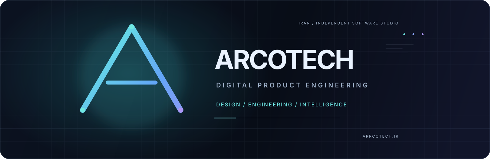

  

<h1 align="center">Arcotech</h1>

<strong>We design and engineer custom digital products that make complex work feel simple.</strong>

Arcotech is an Iranian software studio founded by **Armin Parivar**. We partner with teams to turn ambitious ideas and operational challenges into dependable digital products — from the first product decision to production-ready software.

## What we do

- **Custom software** — purpose-built systems shaped around real business workflows.
- **Web applications** — fast, accessible, maintainable products built for the web.
- **UI/UX design** — clear product experiences with thoughtful interaction and visual systems.
- **Business automation** — connected workflows that reduce repetitive work and improve visibility.
- **AI & intelligent systems** — practical AI features, LLM integrations, and task-oriented assistants.
- **SaaS products** — scalable product foundations, from MVP architecture to ongoing evolution.

## Technology

| Area | Tools |
| --- | --- |
| Product engineering | Next.js, React, TypeScript |
| Data & persistence | Prisma, PostgreSQL |
| Infrastructure | Docker, Linux, CI/CD |
| Intelligent features | AI, LLM integrations, automation |

We choose technology for the problem at hand — not for a trend or a logo wall.

## Selected work

A selection of products and systems built across education, operations, commerce, and digital experiences:

- **SilkStudy** — language-learning platform and administration system.
- **Mehrad Institute** — multilingual education and event platform.
- **Epic Universe** — online community and game experience.
- **Nice Cafe** — digital menu and café operations experience.
- **ARCO Assistant** — local-first personal AI assistant concept.
- **Rahagostar Electronic** — corporate digital presence for an engineering services business.
- **British Talent Academy** — education brand and digital experience.
- **Mani Mehr** — digital product and brand experience.

[Explore Arcotech’s portfolio](https://arrcotech.ir/portfolio) · [View services](https://arrcotech.ir/services)

## Contact

- Website: [arrcotech.ir](https://arrcotech.ir)
- Email: [Arrcotech@gmail.com](mailto:Arrcotech@gmail.com)
- Founder & CEO: **Armin Parivar**

---

## درباره آرکوتک

**آرکوتک** یک استودیوی نرم‌افزاری ایرانی به مدیریت و بنیان‌گذاری آرمین پریور است. ما از شناخت مسئله و طراحی محصول شروع می‌کنیم و راهکارهای نرم‌افزاری دقیق، قابل اتکا و توسعه‌پذیر می‌سازیم.

### خدمات

- طراحی و توسعه نرم‌افزار اختصاصی و اپلیکیشن‌های تحت وب
- طراحی تجربه و رابط کاربری (UI/UX)
- اتوماسیون فرایندهای کسب‌وکار
- راهکارهای هوش مصنوعی و یکپارچه‌سازی مدل‌های زبانی
- طراحی و توسعه محصولات SaaS

### فناوری‌ها

Next.js، TypeScript، Prisma، PostgreSQL، Docker و ابزارهای هوش مصنوعی و LLM.

### ارتباط با ما

- وب‌سایت: [arrcotech.ir](https://arrcotech.ir)
- ایمیل: [Arrcotech@gmail.com](mailto:Arrcotech@gmail.com)

[مشاهده نمونه‌کارها](https://arrcotech.ir/portfolio)

